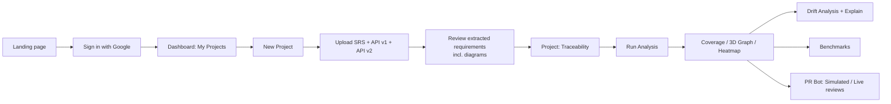
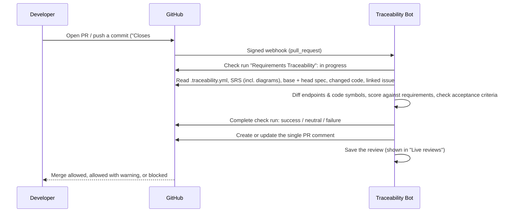

# AI-Assisted Requirements Traceability & Specification Analysis — Project Overview

> **What this document is:** one place that explains the product: the pitch, every feature from the
> user's side, and the exact path a user takes through the website and through GitHub.
> **Last updated:** 2026-10-21 · all features below are built and covered by automated tests.

**Contents**
1. [The Perfect Pitch](#section-1-the-perfect-pitch)
2. [Functional Features (User's Perspective)](#section-2-functional-features-users-perspective)
3. [Website Flow & User Journey](#section-3-website-flow--user-journey)

---

## Section 1: The Perfect Pitch

### The hook

> A developer opens a small pull request called *"frictionless checkout"*. It removes one field from
> the checkout API. Every test passes, so it gets merged. Six months later an auditor finds that orders
> over $500 no longer need two-factor authentication, and the company has a security incident.
>
> Nothing in the code was "broken". What broke was the **meaning**: the API stopped doing what the
> requirements document asked for. The rule was not even written as a sentence. It was a **UML diagram
> on page 7 of the SRS**, so nobody checked it.
>
> **Our bot would have blocked that pull request, and its comment would have pointed to that diagram.**

### The problem: specification drift

Software is described twice, by two different groups of people:

| Who | Writes | In what language |
|---|---|---|
| Business analysts, product owners | The **SRS** (Software Requirements Specification) | Plain English, tables and **diagrams** in Word or PDF |
| Developers | The **API specification** (OpenAPI) and the code | Technical JSON/YAML and Python |

Over many releases the two drift apart. We call this **specification drift**. It is dangerous because:

- **It is silent.** No test fails and no linter complains.
- **It adds up.** Many small "clean-ups" become one large compliance failure.
- **The words differ.** "Unique transaction id", "idempotency key" and "audit reference" can mean the
  same thing, so keyword search cannot connect them.
- **Requirements hide in pictures.** Real SRS documents put many rules in UML activity, sequence and
  use-case diagrams, and normal tools never read those.
- **It is expensive.** In banking, healthcare and e-commerce, undetected drift leads to failed audits and fines.

Existing tools do not solve this:

| Tool | What it checks | What it misses |
|---|---|---|
| Jira / DOORS trace links | That someone typed a link | Whether the code really does what the link claims |
| API linters (Spectral) | That the file is well formed | Whether it matches the business rule |
| Keyword / TF-IDF search | Matching words | The same meaning in different words |
| Manual review | Everything, slowly | Does not scale to hundreds of endpoints and requirements |

### Who it is for

| Audience | What they get |
|---|---|
| **Developers** | A review on every pull request, *before* merge, that says which requirement a change breaks, why, and how to fix it |
| **QA engineers / test leads** | Proof that every requirement is covered by an endpoint before a release, and a list of the gaps |
| **Project and product managers** | One compliance score per project, a drift report between API versions, and evidence for audits |
| **Architects and auditors** | Reproducible, explainable numbers: the AI explains the result, it never decides it |

### The solution

We teach a computer to **compare meaning, not words**.

1. **Read the SRS like a person would.** Upload a messy Word, PDF or Markdown SRS. The tool finds the
   requirements in tables, tagged headings and "shall" sentences, removes the boilerplate (cover page,
   revision history, table of contents, glossary, appendices), and **reads the diagrams too**: a vision
   model turns a UML diagram into requirement statements.
2. **Read the API.** Every OpenAPI endpoint becomes one text that includes its fields and descriptions.
3. **Compare meaning.** A transformer model (`all-mpnet-base-v2`) turns each requirement and each
   endpoint into a 768-number "meaning fingerprint". Cosine similarity gives a score from 0 to 1 for
   every pair. Together these scores form the **traceability matrix**.
4. **Watch every change.** A GitHub App re-checks the matrix on every pull request and posts
   **PASS**, **WARN** or **BLOCK**, with a plain-English explanation.

### High-level features

- **Semantic traceability.** Requirement-to-endpoint matching by meaning, shown as a coverage list, a
  heatmap and an interactive **3D graph**.
- **Industrial SRS ingestion.** Word `.docx`, PDF and Markdown, with noise removal and an extraction
  report you can check before analysis.
- **Diagram-aware parsing (new).** UML, flowcharts and architecture figures are read with a vision LLM,
  alt text or OCR. A requirement that exists only as a picture is still traced and protected.
- **Drift detection.** Compare API v1 and v2 against the same requirements, with Minor, Major and
  Critical severity.
- **Plain-English explanations.** An LLM writes *what changed, why it breaks the rule, how to fix it*.
- **GitHub integration.** A real GitHub App with a check run, an always-current PR comment, merge
  blocking through branch protection, and the linked issue's acceptance criteria checked.
- **AST code scanning.** When a pull request changes Python code, the changed functions and classes
  (found through the abstract syntax tree) are compared with the requirements, using a code-aware
  embedding model.
- **CI/CD gate.** The same engine runs as a GitHub Action or a CLI with exit codes, with no server needed.

### Why our approach is right

- **Meaning, not keywords.** Our model scores **F1 0.71 vs 0.34** for the TF-IDF keyword baseline,
  and ranks the correct endpoint first for every requirement (**MAP 1.00**).
- **Explainable, not a black box.** The score is plain maths, so anyone can reproduce it. The LLM only
  writes the explanation; it never sets a score or a verdict.
- **Diagrams are first-class.** In our end-to-end test, REQ-09 (two-factor authentication) exists **only**
  as a UML activity diagram. The tool read it, traced it to the right endpoints (best match 0.85), found
  its drift in API v2, and blocked the pull request that removed 2FA. The comment named "SRS Figure 2" as
  the source.
- **Shift-left.** Drift is caught in the pull request, not in an audit six months later.

### Proof it works

| Check | Result |
|---|---|
| Automated tests | **482 passing** (unit, API, GitHub App, code-aware, diagram parsing, end-to-end) |
| End-to-end lifecycle test (upload → analysis → 4 live PR reviews) | **24 / 24 checks pass** with the real vision model and real LLM |
| Semantic model vs keyword baseline | F1 **0.71 vs 0.34**, MAP **1.00** |
| Same SRS as `.docx`, `.pdf` and `.md` | Identical requirements and identical scores (parity test) |
| PR bot on the demo pull requests | PASS on the safe change, BLOCK on both breaking changes, WARN on the partly delivered issue |

### One-line summary

> **We built an AI system that reads your requirements, including the diagrams, and your API and code,
> measures whether the software still means what the business asked for, explains every gap in plain
> English, and blocks the pull request before the drift is merged.**

---

## Section 2: Functional Features (User's Perspective)

Everything below is something a user can actually do today.

### 2.1 Account and projects

- **Sign in with Google.** One click and no new password. The session is kept with secure tokens.
- **Create projects.** Each product or API gets its own project with its own documents and results.
  Users only ever see their own projects.
- **Delete projects** you no longer need.

### 2.2 Uploading documents

- **Upload a real, messy SRS.** Word `.docx`, PDF (with a text layer), Markdown or plain text, up to 10 MB.
  The tool understands:
  - requirement **tables** (`ID | Title | Description | Priority`, one-card-per-requirement tables,
    tables without a header row, merged cells, tables that continue across pages);
  - **tagged** headings and paragraphs (`FR-1`, `REQ-04`, `[NFR-2]`, `BNK-REQ-01`, `3.2.1 FR-7 …`);
  - plain **"The system shall…"** sentences, when a document has no IDs at all;
  - Word details such as content controls, tracked changes (deleted text is ignored), callout boxes and
    nested tables.
- **Diagrams are read, not thrown away.** For every figure in the SRS (UML use-case, activity, sequence
  or state diagrams, flowcharts, architecture drawings):
  - a **vision LLM** reads the picture and writes the requirements it shows as "The system shall…"
    statements, keeping the names, limits, fields and endpoints from the drawing;
  - if the figure or its caption shows a requirement ID (for example "Figure 2: REQ-09 …"), the
    requirement keeps that ID;
  - a diagram that only *illustrates* a requirement already written in the text is attached to that
    requirement as context, so nothing is duplicated;
  - architecture and context diagrams (boxes and arrows) are kept as context, not turned into vague
    requirements;
  - figures in appendices, glossaries and other boilerplate sections are skipped and never sent to the model;
  - without an API key, figures are read from their **alt text** or by **OCR** (Tesseract).
- **Noise is removed automatically:** cover page, revision history, table of contents, definitions and
  glossary, references, appendices, captions, page numbers, and running headers and footers.
- **Upload the API specs.** OpenAPI v1 (the baseline) and, optionally, v2 (the new version), as JSON or YAML.
- **Clear errors instead of crashes.** Wrong file type, a fake `.docx`, a macro-enabled document, an
  oversized file or a scanned PDF each get a specific message that says how to fix it.

### 2.3 Reviewing what was extracted (before analysis)

- **Requirement preview.** Right after upload you see:
  - "Extracted **N** requirements", with chips such as *6 from requirement tables · 3 from tagged
    headings · 1 read from diagrams*;
  - the boilerplate sections that were removed, and the noise that was cleaned;
  - a **"Read N diagrams"** panel with each figure's caption, its type (activity, sequence, …), a short
    summary, and which requirements it created or illustrates;
  - every requirement, with a click to expand its text, location in the document ("table 3 / row 5",
    "figure 2"), section, type and priority. Diagram requirements carry a **diagram** badge, and
    generated IDs carry a warning badge;
  - warnings, such as a duplicate ID or a requirement too long for the model to read fully.
- **Open the same preview at any time** from the project page ("Requirements extracted from the SRS").

### 2.4 Traceability analysis

- **Run Analysis with one button.** The tool parses, embeds and scores everything, and stores the result.
- **Headline numbers:** requirements covered, overall compliance, endpoints analysed, strong matches.
- **Four views of the traceability matrix:**
  - **Coverage:** each requirement with its best endpoints and a compliance band (green, amber, red);
  - **Graph:** an interactive **3D force graph** of requirements linked to the endpoints that implement them;
  - **Heatmap:** the full requirement × endpoint similarity matrix;
  - **Split:** coverage and graph side by side.
- **Click a requirement** to see its matching endpoints and scores.

### 2.5 Drift analysis (API v1 → v2)

- **Compliance before and after**, and which requirement–endpoint pairs lost alignment.
- **Severity for every drift:** Minor, Major or Critical.
- **"Explain" button** on any drift: an LLM writes three plain sentences:
  1. *What changed* in the API;
  2. *Why it violates* the requirement;
  3. *The remediation*: the exact change that restores compliance.
  Without an API key a structured template is shown instead; the tool never crashes.

### 2.6 PR Bot

- **Simulated tab:** try the bot on built-in pull requests (an additive change, a refund change and a
  2FA removal) and see the verdict and the full review comment, without GitHub.
- **Live reviews tab:** every real pull request the GitHub App reviewed, with repo, PR link, verdict
  badge and time. Open one to see the violations, the check run and the exact comment posted on GitHub.
- **On GitHub, for every pull request:**
  - a **"Requirements Traceability" check run** with PASS, WARN or BLOCK, a summary table and the explanations;
  - **one PR comment** that is updated on every push (no comment spam), showing every violation with
    the requirement, the endpoint or code symbol, the score before and after, the drop, the severity,
    the **source of the requirement** (for example "SRS Figure 2 · activity diagram"), and the
    plain-English explanation;
  - the **linked issue** (`Closes #12`) is read and its acceptance criteria are checked against what
    the PR actually adds;
  - **merge blocking** when the check is a required status check in branch protection;
  - a **Re-run** button on the check.
- **AST code scanning:** if the repo's config lists code paths (`code: { paths: ["app/**/*.py"] }`), a
  PR that changes Python handlers but not the spec is still reviewed: each changed function or class
  is compared with the requirements, and the comment shows the symbol and its `file:line`.

### 2.7 Benchmarks

- **Accuracy report:** Precision, Recall, F1 and MAP of the semantic model against a TF-IDF keyword
  baseline, so the quality of the matching is measured, not assumed.

### 2.8 For CI/CD and power users

- **`.traceability.yml`** in the repo: SRS path, spec path(s), thresholds, `fail_on`
  (`block` / `critical` / `never`), SRS extraction options (custom ID pattern, diagram mode), and code paths.
- **GitHub Action** (`action.yml`): the same review in any repository's workflow, with no server. The
  report is shown in the job summary.
- **CLI** (`python -m src.cli`): `extract-srs`, `analyze`, `review`, with exit codes 0 (PASS/WARN), 1 (BLOCK), 2 (error).

---

## Section 3: Website Flow & User Journey

### 3.1 The journey at a glance



### 3.2 Step by step on the website

| # | Screen | What the user does | What happens |
|---|---|---|---|
| 1 | **Landing page** (`/`) | Reads what the product does and clicks to sign in | — |
| 2 | **Login** (`/login`) | Clicks **Sign in with Google** and picks an account | Google confirms who they are; the backend issues a session token. A clear message appears if Google rejects the sign-in |
| 3 | **Dashboard: My Projects** (`/dashboard`) | Sees their projects, or "No projects yet" | Only this user's projects are listed |
| 4 | **New Project** | Clicks **New Project**, types a name and description, clicks **Create Project** | An empty project card appears |
| 5 | **Upload** | Clicks **Upload** on the card and drops in three files: the **SRS** (`.docx` / `.pdf` / `.md` / `.txt`), **API v1** and optionally **API v2** (`.json` / `.yaml`). Clicks **Upload Files** | Each file is checked (type, size, real content). The SRS is parsed immediately: tables, tags, shall-statements and **diagrams** |
| 6 | **Review extracted requirements** | Reads the preview: the count, the strategy chips, the **diagrams read**, the removed boilerplate, the warnings and each requirement. Clicks **Looks good** (or **Upload more files** to fix something) | If no requirement is found, the upload is rejected with a report of what was seen and how to fix the document |
| 7 | **Project → Traceability** (`/projects/:id`) | Clicks **Run Analysis** | The first run loads the AI model (about 30–60 s). Then the headline numbers and the Coverage, Graph, Heatmap and Split views appear |
| 8 | **Explore the matrix** | Switches views, rotates the 3D graph, clicks a requirement | Its best endpoints and scores are shown |
| 9 | **Drift Analysis** | Reviews the v1 → v2 drifts and clicks **Explain** on one | The plain-English *what changed / why it breaks / how to fix* appears |
| 10 | **Benchmarks** | Reads Precision, Recall, F1 and MAP | Semantic model vs keyword baseline |
| 11 | **PR Bot** | *Simulated* tab: picks a scenario and clicks **Run review**. *Live reviews* tab: opens a real GitHub review | Shows the verdict and the full bot comment |

### 3.3 The GitHub pull-request flow

#### One-time setup (by a team lead)

1. **Install the GitHub App** "Traceability Bot" on the repository.
2. **Commit a `.traceability.yml`**, for example:
   ```yaml
   version: 1
   srs: docs/SRS.docx            # Word, PDF or Markdown, diagrams included
   openapi: openapi.yaml
   fail_on: block                # block | critical | never
   srs_extraction:
     diagram_mode: vision        # read UML / flowcharts with the vision model
   code:                         # optional: AST scanning of Python code
     paths: ["app/**/*.py"]
   ```
3. **Turn on branch protection** for `main` and mark **"Requirements Traceability"** as a required
   status check. A BLOCK now disables the merge button.

#### What happens on every pull request



How the developer interacts with the bot:

1. **Open a pull request** that changes the spec (or code under `code.paths`), and link the issue it
   solves with `Closes #12`, `Fixes #12` or `Resolves #12`.
2. **Watch the check.** Within seconds "Requirements Traceability" shows as *in progress*, then
   completes with ✅ *success*, ⚪ *neutral* or ❌ *failure*.
3. **Read the comment.** It lists every violation, the requirement and where it is defined in the SRS
   (including "SRS Figure 2 · activity diagram" for diagram requirements), the score drop, the
   severity and the AI explanation.
4. **Fix and push.** Each new push re-reviews the PR and **updates the same comment**. The
   **Re-run** button on the check repeats a review on demand.
5. **Merge** once the check passes (or is neutral, if your policy allows warnings).

#### When you get PASS, WARN or BLOCK

The verdict is **deterministic**: it comes from the scores and fixed thresholds, never from the LLM.

| Verdict | GitHub check | When it happens | Example (from our end-to-end test) | Merge |
|---|---|---|---|---|
| ✅ **PASS** | `success` | No requirement lost alignment, **and** the linked issue's acceptance criteria are delivered (or no issue is linked) | PR #101 adds an *optional* `discount_code` to add-to-cart. Every requirement keeps its score; the issue "Support discount codes" is delivered | Allowed |
| ⚠️ **WARN** | `neutral` | No requirement regressed, **but** the linked issue is only partly delivered (an acceptance criterion has no matching added or modified endpoint) | PR #104 adds a wishlist endpoint, but the issue also asks for price-drop emails: *"WARN: the linked issue is only partly delivered (50% covered)"* | Allowed, with a visible warning |
| 🚫 **BLOCK** | `failure` | At least one requirement **regressed**: an endpoint or code symbol that implements it lost meaningful alignment (see the rule below) | PR #102 "frictionless checkout" drops the 2FA token from checkout → **REQ-09** regressed (0.617 → 0.560), a requirement that exists only as a UML diagram. PR #103 replaces the client `transaction_id` with a server reference → **REQ-04** regressed | Blocked (with branch protection) |

**The regression rule (BLOCK).** For each endpoint or code symbol the PR modifies or removes, the bot
re-scores it against the requirements it implements (its top-3 trace links in the base version):

- the link was **strong** (score ≥ 0.60) and dropped by **0.05** or more, or
- the link was **medium** (score ≥ 0.35) and dropped by **0.08** or more.

Each violation also gets a **severity** (Minor, Major or Critical) from the size of the drop. All
thresholds can be changed in `.traceability.yml`.

**Policy (`fail_on`).** `block` (default) fails the check on any BLOCK. `critical` fails only on
Critical drift, which suits a `main`-branch deploy gate. `never` is advisory mode: the bot comments
but never fails.

**Other outcomes you may see:**

| Outcome | Check | Why |
|---|---|---|
| *Skipped: no `.traceability.yml`* | `neutral` | The repository is not configured yet |
| *Skipped: no specification change* | `neutral` | The PR does not touch the SRS, the spec, the config or the watched code |
| *Error: SRS not found / invalid OpenAPI spec / could not read the SRS* | `failure` | The configured file is missing or broken. The message says which file and why; fix it and press **Re-run** |

### 3.4 The same flow without a server (GitHub Action)

Teams that do not want to host the App add the Action to a workflow:

```yaml
- uses: raghavvag/<repo>@v1
  with: { config: .traceability.yml, fail-on: block }
```

The job runs the same engine on GitHub's runners and writes the report to the job summary. A BLOCK
fails the job, which blocks the merge when the job is a required check. The App and the Action always
agree, because they share one review engine.
